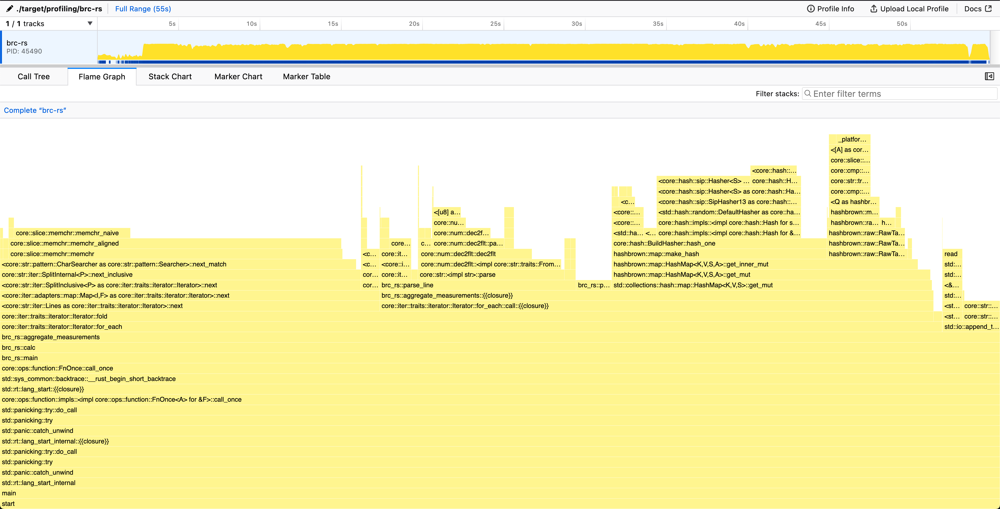
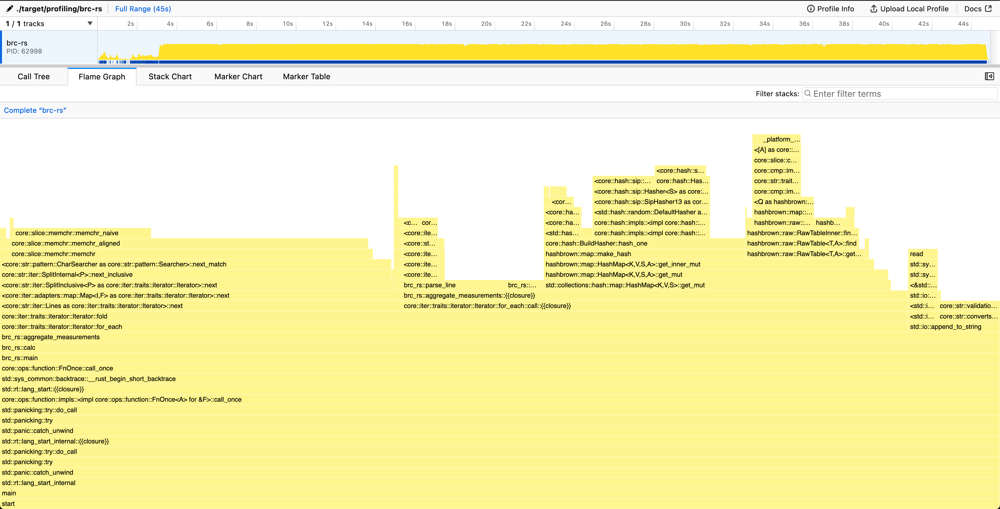
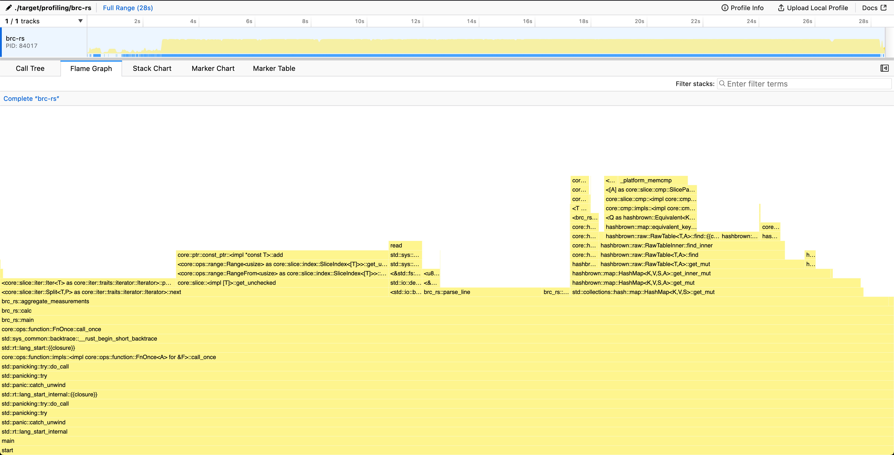
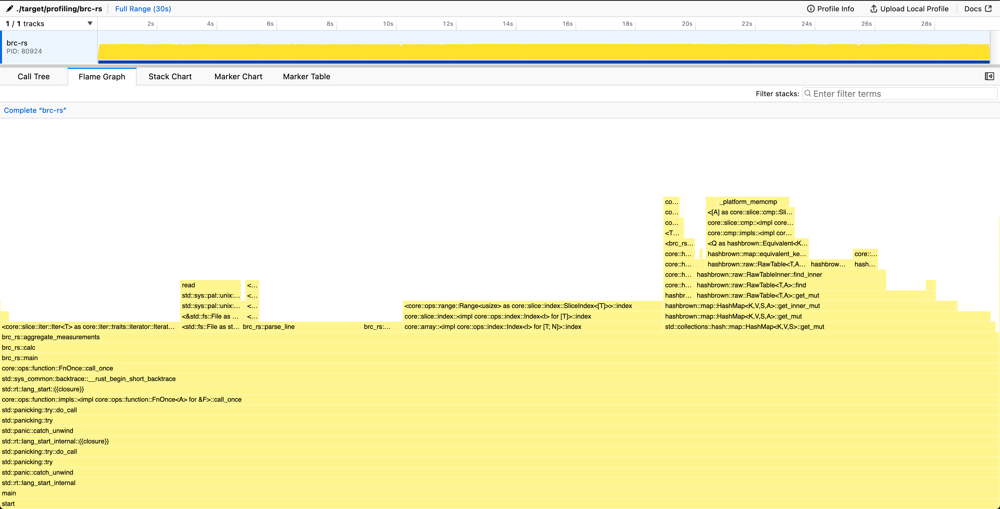
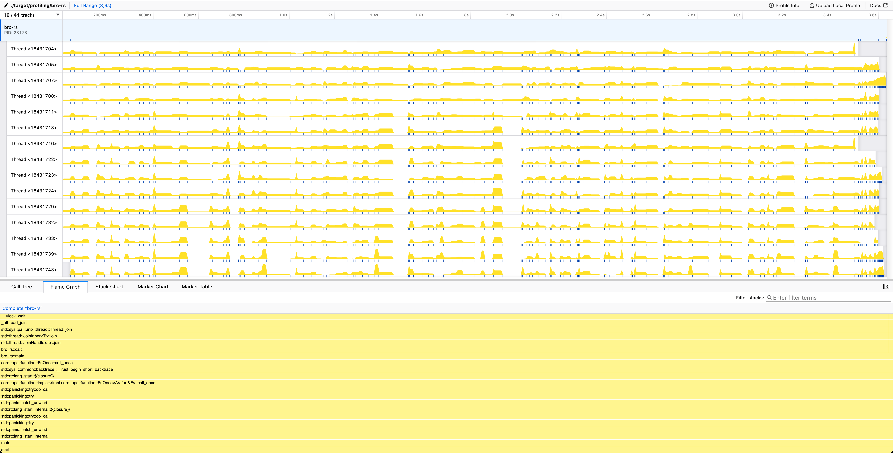

# One Billion Row Challenge in Rust

This repository contains my implementation in Rust for the One Billion Row Challenge (1BRC), which tests the limits of processing one billion rows from a text file. [Original challenge repository](https://github.com/gunnarmorling/1brc)

The main idea is to explore optiziming performance of a program through profiling and parallellism, with also trying to use only ["Safe Rust"](https://doc.rust-lang.org/nomicon/meet-safe-and-unsafe.html#meet-safe-and-unsafe). All error handling of this project is handled poorly knowingly, and only the happy path is considered.

## Challenge

The text file contains temperature values for a range of weather stations.
Each row is one measurement in the format `<string: station name>;<double: measurement>`, with the measurement value having exactly one fractional digit.
The following shows ten rows as an example:

```
Hamburg;12.0
Bulawayo;8.9
Palembang;38.8
St. John's;15.2
Cracow;12.6
Bridgetown;26.9
Istanbul;6.2
Roseau;34.4
Conakry;31.2
Istanbul;23.0
```

The task is to write a program which reads the file, calculates the min, mean, and max temperature value per weather station, and emits the results on stdout like this
(i.e. sorted alphabetically by station name, and the result values per station in the format `<min>/<mean>/<max>`, rounded to one fractional digit):

```
{Abha=-23.0/18.0/59.2, Abidjan=-16.2/26.0/67.3, Abéché=-10.0/29.4/69.0, Accra=-10.1/26.4/66.4, Addis Ababa=-23.7/16.0/67.0, Adelaide=-27.8/17.3/58.5, ...}
```

## Optimization Results

Here is a table for a quick summary of the current progress of the optimizations.
Benchmarks and profiling results shown below are run against a `measurements.txt` generated with `./create_measurements.sh 1000000000`, having 1 billion entries using a 10-core 14" Macbook M1 Max 32 GB.

| Optimization                                                                                  | Time (mean ± σ):  | Improvement over previous version                      | Summary                                                                                                                  |
| --------------------------------------------------------------------------------------------- | ----------------- | ------------------------------------------------------ | ------------------------------------------------------------------------------------------------------------------------ |
| [Initial Version](#initial-version)                                                           | 149.403 s ± 0.452 | N/A                                                    | Naive single-core implementation with BufReader & HashMap                                                                |
| [Unnecessary string allocation](#unnecessary-string-allocation)                               | 102.907 s ± 1.175 | <strong style="color:lime;"> -46,496 s (-31%)</strong> | Remove an unnecessary allocation of a string inside loop                                                                 |
| [Iterate over string slices instead of String](#iterate-over-string-slices-instead-of-string) | 63.493 s ± 1.368  | <strong style="color:lime;"> -39,414 s (-38%)</strong> | Read the entire file into memory first, iterate over string slices, move away from using Entry API for accessing hashmap |
| [Improving the line parsing #1](#improving-line-parsing)                                      | 55.686 s ± 1.304  | <strong style="color:lime;"> -7,807 s (-12%)</strong>  | Replace `str::find` with a custom, problem-specific separator finder                                                     |
| [Improving the line parsing #2](#writing-a-custom-measurement-parser)                         | 44.967 s ± 0.542  | <strong style="color:lime;"> -10,719 s (-19%)</strong> | Custom, byte based measurement value parser building on top of previous optimization                                     |
| [Use `Vec<u8>` everywhere instead of `String`](#using-vecu8-instead-of-string)                | 38.470 s ± 0.485  | <strong style="color:lime;"> -6,497 s (-14%)</strong>  | Time save mostly from not needing to do UTF-8 validation when using `Vec<u8>`, as that is not necessary.                 |
| [a custom hash function](#using-a-custom-hash-function)                                       | 30.427 s ± 0.455  | <strong style="color:lime;"> -8,043 s (-21%)</strong>  | Use a custom hash function for the hashmap that is used by the Rust Compiler                                             |
| [Custom chunked reader](#chunked-reader-to-reduce-memory-footprint--prepare-for-parallellism) | 29.310 s ± 0.276  | <strong style="color:lime;"> -1,117 s (-4%)</strong>   | Write a custom chunked file reader to prepare for parallellism and reduce memory allocation                              |
| [Tweak chunk size](#tweaking-the-chunk_size)                                                  | 28.663 s ± 0.546  | <strong style="color:lime;"> -0,647 s (-2%)</strong>   | Small tweak for the fixed buffer-size created in previous improvement                                                    |
| [Multithreading](#multithreading)                                                             | 3.747 s ± 0.093   | <strong style="color:lime;"> -24,916 s (-87%)</strong> | Multithread the program to utilize all cores on the system                                                               |

### Initial Version

Nothing special really, just a quick version to get things going with a `HashMap<String,WeatherStationStats`.

Struggled too long with getting a correct implementation of the rounding calculation to pass the original test suite.

Going forward, the rounding conventions will change, with the test files being generated with the initial version of this project with only the conversion logic changed.

```sh
~/src/github/brc-rs (master*) » ./bench.sh
Benchmark 1: ./target/release/brc-rs
  Time (mean ± σ):     149.403 s ±  0.452 s    [User: 144.499 s, System: 2.486 s]
  Range (min … max):   149.037 s … 150.110 s    5 runs
```


Looking at the flame graph, we spend ~30% of the time in `<std::io::Lines as core::iter::traits::iterator::Iterator>::next`. That is, reading the file line by line. This most likely due to the use of [`BufRead::lines()`](https://doc.rust-lang.org/std/io/trait.BufRead.html#method.lines) for iterating the lines, as it creates a new `String` for each row, allocating memory. This allocation of each line separately creates unnecessary overhead, and probably should be looked into first.

Inside the `calc`-function we also spend 13% of the time creating strings and 17% of the time dropping Strings, freeing the allocated memory. We spend 16% in actually parsing the line, and 22% doing hashmap operations.

### Unnecessary string allocation

Even though the profile indicates that looking into the reading of the file should probably be looked into first, during writing the previous analysis I realized that I made a totally unnecessary string allocation inside `calc`.

As we receive a String from the iterator already and it isn't used in any other way than passed as a string slice to `parse_line`
, we can instead pass it to `parse_line` and return the original line string but truncated to only contain the station name.
By doing this, we can use that as the key for the hashmap instead of allocating a new string entirely for it.

```sh
~/src/github/brc-rs (main*) » ./bench.sh
Benchmark 1: ./target/release/brc-rs
  Time (mean ± σ):     102.907 s ±  1.175 s    [User: 98.842 s, System: 2.179 s]
  Range (min … max):   101.440 s … 104.566 s    5 runs
```

This just goes to show that allocating another string unnecessarily with this amount of data has already a significant impact on performance.


### Iterate over string slices instead of String

The reading of the file has grown to 44% time spent. This needs to be addressed.

Let's first investigate the iterator performance with writing some test programs:

```rust
// test-bufread-lines.rs
use std::io::BufRead;
fn main() {
    let now = std::time::Instant::now();
    let f = std::fs::File::open("measurements.txt").unwrap();
    let reader = std::io::BufReader::new(f);
    let mut amount_read = 0;
    for line in reader.lines() {
        amount_read += line.unwrap().len() + 1; // add the newline character back
    }
    println!("reading {amount_read} bytes took {:#?}", now.elapsed());
}
```

This program emulates the current implementations line iteration by using the [`BufRead::lines`](https://doc.rust-lang.org/std/io/trait.BufRead.html#method.lines)-function to iterate over each line.
Note that the lines returned are all of type `String` underneath.

```sh
~/src/github/brc-rs (main*) » rustc -O test-bufread-lines.rs
~/src/github/brc-rs (main*) » hyperfine ./test-bufread-lines
Benchmark 1: ./test-bufread-lines
  Time (mean ± σ):     55.872 s ±  0.080 s    [User: 53.816 s, System: 1.860 s]
  Range (min … max):   55.764 s … 56.055 s    10 runs
```

So 55 seconds for iterating the file line by line? That seems kind of slow. Let's try to see if we can improve on that.

Now let's look at the following program:

```rust
// test-read-to-string-lines.rs
use std::io::Read;
fn main() {
    let now = std::time::Instant::now();
    let f = std::fs::File::open("measurements.txt").unwrap();
    let mut reader = std::io::BufReader::new(f);
    let mut s = String::new();
    reader.read_to_string(&mut s).unwrap();
    let mut amount_read = 0;
    for line in s.lines() {
        amount_read += line.len() + 1; // add the newline character back
    }
    println!("reading {amount_read} bytes took {:#?}", now.elapsed());
}
```

Instead of using `BufRead::lines`, here we first read the entire file into a `String` and then iterate over the lines with `str::lines`.

```sh
~/src/github/brc-rs (main*) » rustc -O test-read-to-string-lines.rs
~/src/github/brc-rs (main*) » hyperfine ./test-read-to-string-lines
Benchmark 1: ./test-read-to-string-lines
  Time (mean ± σ):     19.514 s ±  0.793 s    [User: 15.472 s, System: 1.311 s]
  Range (min … max):   18.939 s … 21.331 s    10 runs
```

Reading the entire string first into memory results in a staggering 66% performance improvement.
The penalty coming from the `BufRead::lines`-iterator is that it allocates every line separately as a `String`.
This means on each line iteration, we allocate (and also de-allocate) memory, which causes significant overhead.
However, reading the entire file into a single String comes with a glaring drawback: the entire file will be stored in memory at once, so the memory footprint will be affected.

```sh
~/src/github/brc-rs (main*) » /usr/bin/time -l ./test-bufread-lines
reading 13795898567 bytes took 56.876117291s
         --- redacted ---
         1114688  peak memory footprint
```

Peak memory footprint of ~1.1 MB when using the buffered reader.

```sh
~/src/github/brc-rs (main*) » /usr/bin/time -l ./test-read-to-string-lines
reading 13795898567 bytes took 21.289027s
          --- redacted ---
         13803464960  peak memory footprint
```

The peak memory footprint is now on the neighbourhood of 13.8GB, so a roughly 10,000x increase over using the buffered reader.
This isn't ideal and not the final solution I'd hope to achieve, but for now it's good enough (and allowed in the original rules, so 🤷).
Further improvements will be done later on, but for that we need to look at other parts to refactor until we can get back to this.

Now that we iterate over string slices instead of strings, we need to revert our `parse_line` to its previous state.
Another problem arises with the [`HashMap::entry()`](https://doc.rust-lang.org/std/collections/hash_map/struct.HashMap.html#method.entry) access method into the hashmap.
The function requires passing the key by value instead of reference, meaning we would need to allocate a new string for the station name on each iteration.
This would result as going back to allocating on each iteration, removing the optimization.
[The Entry API in the standard library doesn't seem to work with expensive keys](https://stackoverflow.com/questions/51542024/how-do-i-use-the-entry-api-with-an-expensive-key-that-is-only-constructed-if-the/56921965#56921965)

Let's instead use [`HashMap::get_mut()`](https://doc.rust-lang.org/std/collections/hash_map/struct.HashMap.html#method.get_mut) with a `match`, either modifying the value or inserting a new one.
Here we limit the allocations to only occur on the inserts, and `get_mut()` happily takes a string slice as argument.

```sh
~/src/github/brc-rs (main*) » ./bench.sh
Benchmark 1: ./target/release/brc-rs
  Time (mean ± σ):     63.493 s ±  1.368 s    [User: 58.224 s, System: 2.112 s]
  Range (min … max):   62.183 s … 65.675 s    5 runs
```


The line reading still uses quite a significant portion of the time (27% line iteration + 9% for loading the string into memory). However, it is not the biggest consumer of time anymore, which indicates we need to change our focus.
We spend 39% of time inside `parse_line()` and need to do some improvements on that next.
The `HashMap::get_mut()` is also starting to creep up in the chart with 23% of time spent.

### Improving line parsing

Now that we have gotten rid of most of the "free" improvements out of the way, we can start looking at actually improving the performance of the parsing logic of the lines.
This section is divided in two parts; finding the data separator followed by improving the parsing logic.

#### Replacing `str::find` with a custom separator finder

Biggest share of time inside `parse_line()` is spent in [`str::find`](https://doc.rust-lang.org/std/primitive.str.html#method.find).
This is used for separating the station name from the measurement data point.
Using a generic "find from string"-function is fine for initial implementation and good for readability, but performance is being left on the table if we don't utilise all the knowledge we have.

Reading the [challenge rules](https://github.com/gunnarmorling/1brc?tab=readme-ov-file#rules-and-limits), we know that the station name is a valid UTF-8 string with length varying between 1 and 100 bytes. The maximum length of the measurement data point is at most 5 characters ("-99.9") and is always pure ASCII.

As the average length of a measurement is much smaller than the UTF-8 string, we can change our approach to start reading the line from the end.
Also as the measurement is known to be pure ASCII, we can iterate over the bytes directly instead of the characters.

This makes finding the separator use at most six byte comparison operations. We could further reduce this down to three, as there is always guaranteed to be 1 fractional digit, a period, and a whole number, but this is improvement is quite insignificant and we'd need to remove it anyway for the next part.

```sh
~/src/github/brc-rs (main*) » ./bench.sh
Benchmark 1: ./target/release/brc-rs
Time (mean ± σ): 55.686 s ± 1.304 s [User: 50.524 s, System: 2.026 s]
Range (min … max): 54.354 s … 57.095 s 5 runs
```



From the graph we see that `parse_line()` has shrunk significantly, with now the floating point value parsing taking majority of the time.

#### Writing a custom measurement parser

At this point we probably already start looking into replacing the standard hashmap with something custom or looking into the line parsing again, but we're not done yet with improving the `parse_line()`-function yet.
Now we'll look at how we can improve parsing the value from the standard [`f64::FromStr`](https://doc.rust-lang.org/std/primitive.f64.html#method.from_str) to something custom based on the information given to us.

Quick recap regarding the specification in the rules regarding the measurement data:

> Temperature value: non null double between -99.9 (inclusive) and 99.9 (inclusive), always with one fractional digit

Based on this information, we always know that there is only a single fractional digit and at most two digits for the whole number part.
What first comes to mind is to convert the number into a whole number entirely by shifting/removing the decimal point from the number, and converting back to decimal in the end.
This would allow us to do all the math with 64-bit integers instead of floating point numbers, that seems to be faster on M1 silicon at least according to this [Stack Overflow post](https://stackoverflow.com/questions/2550281/floating-point-vs-integer-calculations-on-modern-hardware). More notably, writing a custom parser for an integer is far more trivial over doing the same for a float.

However, we are immediately met with an issue: we have a string slice, how should we go around of creating the integer? [`str::replace`](https://doc.rust-lang.org/std/primitive.str.html#method.replace) the '.' and [`i64::FromStr`](https://doc.rust-lang.org/std/primitive.isize.html#impl-FromStr-for-isize)? That would decimate our performance, as `str::replace` returns a String, i.e. allocates memory, which we already have determined to be really slow in previous sections. Also at least for the moment, swapping places with the fractional digit and the '.' is not possible either, as that would require for us to have a `&mut str`, which isn't provided by the line iterator.

There was a slight hint in the previous section of the answer for this problem. When we reverse iterate the bytes to find the semicolon separating the station name and the measurement, we also go through all of the bytes of the measurement itself. We can then parse these bytes accordingly, converting the ASCII-number characters into numbers one by one, multiplying by 10 and 100 for the whole numbers to shift them in base ten. Conversion from ASCII to a decimal number works so that we remove 48 (or `b'0'` with Rust syntax), from each byte-value, as the numbers from 0 to 9 are in order in ASCII, starting from 48 for '0'.

```sh
~/src/github/brc-rs (main*) » ./bench.sh
Benchmark 1: ./target/release/brc-rs
  Time (mean ± σ):     44.967 s ±  0.542 s    [User: 39.777 s, System: 1.882 s]
  Range (min … max):   44.196 s … 45.416 s    5 runs
```


After these improvements, we have reduced our time spent in `parse_line()` from 39% to 14%.
Quite happy with that, and time to look at other places for improvements, namely either the line-iterator or the hashmap operations.

### Using `Vec<u8>` instead of `String`

Now that our `parse_line()` function is totally custom, and both user bytes directly, there is no need for us to use strings anymore.
On the right corner of the previous flamegraph, we can see that we spend around 5% of the program in something called `core::str::validations:run_utf8_validation`.
This is UTF-8 string validation, as all `String`-types must be valid UTF-8 in Rust it runs always when not using `unsafe`.

As none of our code beneath relies on having string slices anymore, we can get an easy win here by converting all Strings and string slices used in `aggregate_measurements()` to use `Vec<u8>` and byte slices respectively.
Our hashmap also changes its signature to `HashMap<Vec<u8>,WeatherStationStats>`, and some string conversion is required in the result string calculation, but those take insignificant time over the hot path.

```sh
~/src/github/brc-rs (main\*) » ./bench.sh
Benchmark 1: ./target/release/brc-rs
Time (mean ± σ): 38.470 s ± 0.485 s [User: 33.038 s, System: 2.247 s]
Range (min … max): 37.837 s … 38.919 s 5 runs
```


The line iterator is still taking up 40% of all the time spent in the program, but optimization beyond this point seems quite difficult, and easier gains can be found elsewhere.
Replacing the standard hashmap implementation seems like the logical step forward.

### A custom hash function

Currently, 23% of all time spent is in `hashbrown::map::make_hash`. This is the conversion of a hashable type (in this case `&[u8]`) to a 64-byte hash enclosed in a `u64`.
This value can then be used to find the value from the underlying data structure, that is hidden from the end-user of a hashmap. Regardless, this is quite slow and can be improved.

Hashmaps in Rust need to be provided a struct implementing the trait [`BuildHasher`](https://doc.rust-lang.org/std/hash/trait.BuildHasher.html).
As one of would guess its task is to build [`Hashers`](https://doc.rust-lang.org/std/hash/trait.Hasher.html).
One is built each time a new hash needs to be calculated.
Hashers built by the same instance of a builder must always result in same output with the same input.

The default `BuildHasher` that is the default for `HashMap` is [`RandomState`](https://doc.rust-lang.org/std/collections/hash_map/struct.RandomState.html).
For each `RandomState`, a new randomized pair of keys is built that it then passes to it's hashers during construction.
These randomized keys are there to prevent [Hash DoS attacks](https://en.wikipedia.org/wiki/Collision_attack) from malicious users.

Given that our input is not malicious, we don't seem to benefit from the randomized seeding of the `HashMap`, so we can instead look for better performance instead.
After looking around into alternatives, I found [`rustc_hash`](https://docs.rs/rustc-hash/latest/rustc_hash/) with quite a quite nice [`Hasher`-implementation](https://docs.rs/rustc-hash/latest/src/rustc_hash/lib.rs.html#76-109).
Originally based on Firefox's hashing algorithm, this crate is used in `rustc` due to it's perforamnce over standard library.
The characteristics of a compiler make it unsusceptible to Hash DoS-attacks.

I took the `Hasher` implementation from that crate and integrated it only with `u64` instead of the original `usize`.
This might technically break the rules a bit, but there are still no dependencies in the project (apart from `rand` and `rand_distr` for the measurements generation binary).

```sh
~/src/github/brc-rs (main*) » ./bench.sh
Benchmark 1: ./target/release/brc-rs
  Time (mean ± σ):     30.427 s ±  0.455 s    [User: 25.203 s, System: 1.876 s]
  Range (min … max):   29.945 s … 31.111 s    5 runs
```



### Chunked reader to reduce memory footprint & prepare for parallellism

In section [Iterate over string slices instead of String](#iterate-over-string-slices-instead-of-string), we moved from reading the file line by line to loading the entire file first into memory instead.
This caused our memory usage to increase to a staggering 13GB, but gained us some performance in not having to allocate and deallocate smaller strings constantly.

However, as mentioned in the section, this was not the optimal/end result we wanted to achieve, and now it's time to go back to that.
Allocating 13GB and reading the entire file is still inefficient, as we are blocked from doing anything for the whole duration when loading the file into memory.
Looking the previous flame graph, this loading the file seems to be taking around 2-3 seconds. Ideally, we'd like to have the I/O distributed evenly along the program.

Where this matters more is when we want to start utilizing multiple cores at once.
With our current approach, when we spawn threads we'd start reading from the file system concurrently with each thread.
This would then be putting more stress on the I/O, Thus blocking all the threads.

To prevent the 13GB allocation and prepare for parallellism, it's time to ditch [`BufReader`](https://doc.rust-lang.org/std/io/struct.BufReader.html) and write our own buffered reader.
The concept is exactly the same as what `BufReader` does under the hood, but with us having full control of the underlying buffer and reading from the file.
We'll create a fixed-size slice of bytes to act as our "buffer" where we'll read bytes into directly from the file handle (or anything that implements [`Read`](https://doc.rust-lang.org/std/io/trait.Read.html)-trait.)

The complexity in this approach is handling the case when we hit the end of the currently read buffer.
As we read a fixed amount in bytes at once, there is no guarantee that we read full lines.
The last characters in the end of our buffer are most likely a start of a new line, but not a complete one.

What we need to do to address is the following:

1. Fill the buffer in its entirety
2. Parse the lines, keeping track of how many bytes we have read from the buffer.
3. Do this until we hit the point where we do not find a newline-character
4. Copy the remainining characters from the end to the start of the buffer.
5. Read from the file to the buffer, but this time starting after the remaining characters we just copied.
6. Repeat until we reach `EOF`. After that exit the loop.

When we reach `EOF`, the [`Read::read`](https://doc.rust-lang.org/std/io/trait.Read.html#tymethod.read) returns `Ok(0)`, indicating that no new bytes were read. Combining with the fact that we only try reading more when we don't have a complete line in the remaining characters, we know that there are no more lines to be parsed, and we can exit the loop.

```sh
~/src/github/brc-rs (main*) » ./bench.sh
Benchmark 1: ./target/release/brc-rs
  Time (mean ± σ):     29.310 s ±  0.276 s    [User: 27.071 s, System: 1.465 s]
  Range (min … max):   29.036 s … 29.696 s    5 runs
```

As expected, not that big of an improvement for the single-core result, only potential we save is that we don't need to allocate 13GB of contiguous memory.

```sh
~/src/github/brc-rs (main*) » /usr/bin/time -l target/release/brc-rs
                ...
29.40 real        27.21 user         1.52 sys
      1261568  maximum resident set size
                ...
      967232  peak memory footprint
```

As we can see, our `peak memory footprint` is again under 1MB.


Now looking at the graph, the ~2-3s I/O blocking for the CPU usage has vanished from the chart.
As we do the same amount of blocking I/O than previously, this just means the blocking is distributed more evenly through the whole execution time.

#### Tweaking the `CHUNK_SIZE`

In the first chunked reader implementation, an arbitrary chunk-size of 50 000 bytes was chosen.
This can be thought of as a byte-interval, after we start reading the file again.
With too small of a chunk-size, we start paying for the I/O overhead unnecessarily.
After some testing, it seems that that 500 000 bytes (0,5 MB) seems to be a better balance between I/O overhead and memory usage on an M1 Mac.

```sh
~/src/github/brc-rs (254edb8) » ./bench.sh
Benchmark 1: ./target/release/brc-rs
  Time (mean ± σ):     28.663 s ±  0.546 s    [User: 26.501 s, System: 1.259 s]
  Range (min … max):   28.304 s … 29.631 s    5 runs
```

### Multithreading

We have now prepared our program to be able to handle multiple threads at once, and we can start utilizing them to speed up the program.

One might wonder why this wasn't done earlier, but profiling and optimizing a single-threaded program is much more straightforward than a multithreaded one.
As long as we keep the fact that we are going to use multiple threads in mind, we can optimize the single-threaded program to be as fast as possible, and then just spawn more threads to do the same work.

We need to somehow divide the work we have done sequentially into multiple threads.
This can be achieved by dividing the file into chunks and then processing each chunk in a separate thread.

However, we need to be careful when creating the chunks, as we need to make sure that we don't split the lines in the middle.
To do this, we can "peek into" the file at `chunk_size`, and then read forwards until we find a newline character.
Then set the next chunk to start after that newline character.

After creating the chunks, we can then spawn a thread for each chunk, and have them process the chunk in parallel.

After a thread is finished, it will insert its results into the shared hashmap, locked by a [`Mutex`](https://doc.rust-lang.org/std/sync/struct.Mutex.html).
As we are using a `Mutex`, only one thread can access the hashmap at a time, blocking other threads from accessing it until the lock is released.
This time isn't a problem, as the amount of time spend holding the lock is minimal compared to the time spent processing the data.

```sh
~/src/github/brc-rs (main*) » ./bench.sh
Benchmark 1: ./target/release/brc-rs
  Time (mean ± σ):      3.747 s ±  0.093 s    [User: 29.739 s, System: 2.102 s]
  Range (min … max):    3.679 s …  3.910 s    5 runs
```


As we can see from the flamegraph, the main thread is mostly waiting for the other threads to finish their work.
Other threads are then doing the actual work of reading the file and processing the data.

Looking at the threads doing the processing, we can see that there are sections where some of the threads have 0% CPU usage.
This is due to I/O blocking, as the thread is waiting for the file to be read into memory.

A slight trick to improve the I/O blocking nature was to create more chunks than there are threads available.
This allows the OS scheduler to switch between threads, potentially enabling I/O blocked threads to be swapped to threads where I/O is not blocked.

## Conclusion

The final(?) result is a program that can process 1 billion rows in 3.7 seconds on a 10-core M1 Macbook Pro.
This is a 97% improvement over the initial version.

A big chunk of the improvement came from multithreading in the end, but without the single-core optimizations done first, we couldn't have been able to parallelize the program as effectively.
Keeping the program single-threaded first allowed us to iterate on the program more easily.

The program is now utilizing all cores on the system, and the I/O blocking is distributed more evenly throughout the program.
The memory footprint is kept low, and the program is quite optimized.

More optimizations could be done, for instance making line parsing branchless, using memory-mapped files, but the latter would require use of `unsafe`-code or external crates, which were not in scope for this project.
For now, I'm quite happy with the results, and I'll leave it at that (for now?)


## Part 2: Revisiting it in 2026

The conclusion above ended with "I'll leave it at that (for now?)". It turns out the question mark was warranted.

In October 2026 I picked the project up again, this time pairing with coding agents: I set the direction and the rules, reviewed and merged every pull request, and the agents did most of the profiling, benchmarking and typing.
The rules stayed the same: safe Rust, no dependencies, standard library only.
I made a single concession along the way, the nightly-only [`std::simd`](https://doc.rust-lang.org/std/simd/index.html), which is still safe code and still part of the standard library.

The M1 Max from Part 1 was not available, so everything below is measured on a Linux VM with 8 cores of an AMD Ryzen 9 5950X.
On it, the version Part 1 ended with processes the billion rows in 3.3 seconds.

The other change is a second dataset. The original challenge also had a [10K variant](https://github.com/gunnarmorling/1brc#rules-and-limits) with 10,000 station names of up to 100 bytes, instead of the 413 mostly short ones in the default file.
Its 10,000 stations are scattered over more of the table than fits in a core's L2 cache, and around 15% of its names are longer than 16 bytes, which makes it a good way to catch optimizations that only work on short names.
Every change from here on was measured on both: the default 1 billion rows, and 200 million rows over 10,000 stations.

Many of the tricks below come from the Java entries of the original challenge.
If you'd rather watch than read, Roy van Rijn's GOTO 2024 talk [Java, How Fast Can You Parse 1 Billion Rows of Weather Data?](https://www.youtube.com/watch?v=EFXxXFHpS0M) is a good tour of how those entries got so fast.

| Optimization | 1B rows (mean ± σ) | 10K stations (mean ± σ) | Summary |
| --- | --- | --- | --- |
| [End of Part 1](#part-2-revisiting-it-in-2026) | 3.300 s ± 0.022 | 1.211 s ± 0.016 | Part 1's final version, re-measured on the new machine |
| [One thread per core](#measuring-before-optimizing) | 3.196 s ± 0.014 <strong style="color:lime;">(-3%)</strong> | 0.934 s ± 0.024 <strong style="color:lime;">(-23%)</strong> | Stop oversubscribing threads, as reads from the page cache don't block |
| [Branchless temperature parsing](#branchless-temperature-parsing) | 2.973 s ± 0.044 <strong style="color:lime;">(-7%)</strong> | 0.906 s ± 0.008 <strong style="color:lime;">(-3%)</strong> | Parse the temperature from a single 8-byte load without branches |
| [SWAR semicolon search](#finding-the-semicolon-8-bytes-at-a-time) | 2.546 s ± 0.084 <strong style="color:lime;">(-14%)</strong> | 0.699 s ± 0.006 <strong style="color:lime;">(-23%)</strong> | Find the ';' 8 bytes at a time |
| [A custom station table](#a-hash-table-of-our-own) | 1.494 s ± 0.006 <strong style="color:lime;">(-41%)</strong> | 0.558 s ± 0.009 <strong style="color:lime;">(-20%)</strong> | Replace `HashMap` with an open-addressing table keyed by the name's first 16 bytes |
| [Reuse the loaded words](#a-hash-table-of-our-own) | 1.263 s ± 0.008 <strong style="color:lime;">(-15%)</strong> | 0.559 s ± 0.003 (0%) | Use the same two words for the ';' search and the key |
| [Shorter per-row path](#a-hash-table-of-our-own) | 1.215 s ± 0.032 <strong style="color:lime;">(-4%)</strong> | 0.546 s ± 0.020 <strong style="color:lime;">(-2%)</strong> | Move long names to a cold path, compare the key word by word |
| [`std::simd`](#reaching-for-stdsimd) | 1.131 s ± 0.005 <strong style="color:lime;">(-7%)</strong> | 0.506 s ± 0.006 <strong style="color:lime;">(-7%)</strong> | Find the ';' in the first 16 bytes with one vector comparison |
| [Hash long names 8 bytes at a time](#long-station-names) | 1.101 s ± 0.011 <strong style="color:lime;">(-3%)</strong> | 0.443 s ± 0.013 <strong style="color:lime;">(-12%)</strong> | Shorten the chain of multiplications in long names' hashes |
| [Two lanes](#parsing-in-lanes) | 0.932 s ± 0.027 <strong style="color:lime;">(-15%)</strong> | 0.436 s ± 0.006 <strong style="color:lime;">(-2%)</strong> | Parse two parts of each buffer side by side |
| [Keep the ';' in the key](#reaching-for-stdsimd) | 0.901 s ± 0.010 <strong style="color:lime;">(-3%)</strong> | 0.421 s ± 0.008 <strong style="color:lime;">(-3%)</strong> | Tell short names apart by their key alone |
| [Min and max only when they change](#min-and-max-only-when-they-change) | 0.844 s ± 0.005 <strong style="color:lime;">(-6%)</strong> | 0.413 s ± 0.020 <strong style="color:lime;">(-2%)</strong> | Branch instead of storing both on every row |
| [Store long names whole](#long-station-names) | 0.832 s ± 0.006 <strong style="color:lime;">(-1%)</strong> | 0.352 s ± 0.021 <strong style="color:lime;">(-15%)</strong> | Handle long names' rows entirely on their own path |
| [Fewer live values, no bounds checks](#parsing-in-lanes) | 0.780 s ± 0.011 <strong style="color:lime;">(-6%)</strong> | 0.328 s ± 0.002 <strong style="color:lime;">(-7%)</strong> | Parse temperatures later, pad by a line and assert once per buffer |
| [Three lanes](#parsing-in-lanes) | 0.738 s ± 0.012 <strong style="color:lime;">(-5%)</strong> | 0.328 s ± 0.002 (0%) | Three parts side by side, now that they fit in registers |
| [Long names with fixed work](#long-station-names) | 0.736 s ± 0.015 (0%) | 0.329 s ± 0.015 (0%) | The same work for long names of any length |
| [`target-cpu=native`](#building-for-the-machine-at-hand) | 0.688 s ± 0.006 <strong style="color:lime;">(-7%)</strong> | 0.305 s ± 0.005 <strong style="color:lime;">(-7%)</strong> | Build for the CPU of the machine running it |

Infrastructure and refactoring changes without an effect on the run time are left out, and the times are measured with `hyperfine`, 5 runs each, with both files in the page cache.

### Measuring before optimizing

Before touching the hot path, the project needed a way to tell a 2% win from noise.

A [Nix](https://nixos.org/) flake now provides the toolchain, hyperfine, samply and perf with `nix develop`.
More importantly, every pull request is now benchmarked in CI against its base branch: both are built, run on both datasets in the same hyperfine session, their outputs are compared byte for byte, and the result is posted as a comment on the pull request.

The first datasets for the 10K case just suffixed the 413 names with `#1`, `#2` and so on, which kept them short.
The challenge's own 10K set is generated by slicing the built-in names together, so the generator now does the same: on average 11 bytes, but with about 1,550 names over 16 bytes, practically the same as the official set.
That change alone shifted where the time went, as we'll see.

One quick win came from the threads: Part 1 spawned four times as many chunks as cores to hide I/O blocking.
With the file in the page cache `read()` never blocks, so the extra threads only added context switches. One thread per core was 3% faster on the default dataset, and 23% on the 10K one.

### Branchless temperature parsing

The custom measurement parser from Part 1 walked the bytes one at a time, with a branch for the sign and one for the number of digits.
The fastest Java solutions use a trick by [merykitty](https://github.com/gunnarmorling/1brc/blob/main/src/main/java/dev/morling/onebrc/CalculateAverage_merykittyunsafe.java) that parses the whole temperature from a single 8-byte load, without any branches:

```rust
fn parse_temperature(word: u64) -> (i64, usize) {
    // ASCII digits have bit 4 set while '.' and '-' do not: locate the '.', which is at byte 1, 2 or 3
    let dot_bit = (!word & 0x1010_1000).trailing_zeros();
    // all ones if the first byte is '-', zero otherwise
    let sign = ((!word << 59) as i64) >> 63;
    // clears the '-'
    let unsigned = word ^ (sign as u64 & b'-' as u64);
    // align the '.' to byte 2, putting tens, ones and tenths digits to bytes 0, 1 and 3
    let digits = (unsigned << 20).wrapping_shr(dot_bit) & 0x0F00_0F0F;
    // a single multiplication sums tens * 100 + ones * 10 + tenths into bits 24..34
    let abs = (digits.wrapping_mul(0x640a_0001) >> 24) & 0x3FF;
    let value = (abs as i64 ^ sign) - sign;
    (value, (dot_bit / 8) as usize + 3)
}
```

The multiplication is the neat part: with the digits in bytes 0, 1 and 3, multiplying by `0x640a_0001` adds `100 * tens`, `10 * ones` and `tenths` together into bits 24 to 34, in one instruction.
Since the position of the '.' tells the length of the temperature, the function also returns where the next line starts, so we no longer search for the newline either.

To load 8 bytes from the last line of a buffer, the read buffer gets a bit of padding after the data.
A test runs every value from -99.9 to 99.9 through it.

### Finding the semicolon 8 bytes at a time

The separator was found by reading the line backwards from its end, which first requires finding the end.
Instead, we can search for the ';' forwards, 8 bytes at a time, with the classic [SWAR](https://en.wikipedia.org/wiki/SWAR) zero-byte test: xor the word with eight ';' bytes, and the bytes that were ';' are now zero, which `(x - 0x0101..01) & !x & 0x8080..80` finds.
The lowest set bit, divided by 8, is the length of the name.

Together these two cut a fifth of the run time on the default dataset, and a quarter on the 10K one. And with parsing that cheap, the profile now had a clear new target: 70% of the time was spent in the `HashMap`.

### A hash table of our own

The standard `HashMap` is general-purpose: it hashes the key, probes its control bytes, and then compares the key, which lives in a separately allocated `Vec<u8>` on the heap.
We know far more about our keys than that.

The replacement is an open-addressing table of 65,536 slots, one 64-byte cache line each, with linear probing.
Each slot stores the first 16 bytes of the station name inline, as two `u64`s, next to the station's statistics.
As the 8-byte words of the name are already loaded for the semicolon search, the same words, masked to the name's length, are the key: a lookup is a multiplication for the hash, and a comparison of two integers.

The table alone cut 41% of the run time. Two follow-ups shortened the path further: reusing the loaded words for both the search and the key instead of loading them twice, and moving everything to do with names longer than 16 bytes out of the hot path into a `#[cold]` function.

One detail from the latter: comparing the key as a `[u64; 2]` compiled to a single 16-byte load of a key that had just been stored as two 8-byte words, and the CPU cannot forward two stores into one wider load, so it stalled. Comparing the words one by one was faster.

### Reaching for `std::simd`

At this point, all the stable tricks for the hot path had been used.
Instead of two 8-byte SWAR searches, `std::simd` lets us compare all of the first 16 bytes to ';' with a single instruction:

```rust
fn parse_name(buf: &[u8], start: usize) -> (usize, [u64; 2]) {
    let bytes = u8x16::from_slice(&buf[start..start + INLINE_KEY_LEN]);
    let semicolons = bytes.simd_eq(u8x16::splat(b';')).to_bitmask() | 1 << INLINE_KEY_LEN;
    let len = semicolons.trailing_zeros() as usize;
    let mask = u8x16::from_slice(&NAME_MASKS[INLINE_KEY_LEN - len..][..INLINE_KEY_LEN]);
    let name = u128::from_le_bytes((bytes & mask).to_array());
    (len, [name as u64, (name >> 64) as u64])
}
```

`std::simd` is portable: the same code compiles to SSE or AVX on x86 and NEON on ARM.
It needs a nightly compiler, so the toolchain is pinned in `rust-toolchain.toml`. 20% fewer instructions per row was worth it.

The mask also keeps the ';' itself in the key for names shorter than 16 bytes.
That sounds odd, but it means two different short names always have different keys, so a lookup no longer needs to compare the lengths at all.

### Long station names

On the default dataset, names of 16 bytes or more are rare. On the 10K dataset, 16% of the rows have one, and those rows took about half of the time.

The first problem was the hash: the bytes past the first 16 were hashed one at a time, each step a multiplication waiting for the previous one. Hashing 8 bytes per step made the 10K dataset 12% faster.

The rest took several rounds. Long names are now stored whole and handled entirely on their own, cold path: a single fixed amount of work for any length, as their lengths are spread evenly and every branch on the length mispredicted.
The name is loaded as six 16-byte chunks, the ';' is found from all of them at once, and the bytes past it are masked to zero:

```rust
fn parse_long_name<const N: usize>(buf: &[u8], start: usize) -> (usize, LongTail<N>) {
    let bytes = &buf[start + INLINE_KEY_LEN..][..N * INLINE_KEY_LEN];
    let chunks: LongTail<N> =
        std::array::from_fn(|i| u8x16::from_slice(&bytes[i * INLINE_KEY_LEN..]));
    let semicolons = chunks.iter().rev().fold(0, |bits: u128, chunk| {
        bits << INLINE_KEY_LEN | chunk.simd_eq(u8x16::splat(b';')).to_bitmask() as u128
    }) | 1 << (N * INLINE_KEY_LEN);
    let tail_len = semicolons.trailing_zeros() as usize;
    let masks = tail_masks::<N>(tail_len);
    (
        INLINE_KEY_LEN + tail_len,
        std::array::from_fn(|i| chunks[i] & masks[i]),
    )
}
```

In wall time this barely registered, but a single thread on the 10K dataset now needs 5% fewer cycles per row, with a third fewer branch mispredictions.

Names shorter than 32 bytes, which covers all the long names of the default dataset, take the same path with a single chunk.
The chunks are hashed by multiplying the 32-bit halves of each 64-bit word with each other after xoring in a key, an [NH-style](https://en.wikipedia.org/wiki/UMAC_(cryptography)#NH_and_RFC_4418) hash, where all the multiplications are independent of each other.

The hash had a lesson of its own: a simpler xor-and-shift fold was slightly faster, until a test generated 10,000 names that differ in pairs of bits 16 bytes apart. They all landed in the same slot, and the run took 72 times longer. Even when the input is not malicious, a hash should not have such an easy pathological case.

### Min and max only when they change

A small one: after a station's first few rows, a new minimum or maximum is rare.
Instead of always computing `min` and `max` and storing both, an `if` around each lets the branch predictor skip the stores almost every time, which was 2–6% faster.

### Parsing in lanes

Each row goes through a chain of dependent steps: find the ';', hash the name, load the slot, compare the key, update the statistics.
Within a row, each step waits for the previous one, while the CPU could do much more at once.

The top Java solutions work around this by parsing several independent parts of the input side by side, and so does this one now.
Each read buffer is split into line-aligned lanes, and a loop advances a cursor in each of them in turn:

```rust
while (0..K).all(|i| cursors[i] < ends[i]) {
    let names = cursors.map(|at| parse_name(buf, at));
    for i in 0..K {
        cursors[i] = record_named_row(buf, stations, cursors[i], names[i]);
    }
}
```

Two lanes made the default dataset 15% faster, even with 7% more instructions. Three lanes, however, were no faster than two: they had more values to keep at once than there are registers, and the compiler spilled them to the stack.

Getting three lanes to pay off took two preparatory changes:

1. Parse each row's temperature only when its row is recorded, instead of together with the names, so fewer values are alive at once.
2. Pad the read buffer by a full line, 128 bytes, instead of 16, and `assert!` once before the loop that every lane ends at least that far from the end of the buffer. From that, the compiler can prove that no load of any row is out of bounds, and drops the bounds checks of every row: about 5 instructions less per row, in safe Rust.

The same `assert!` without the first change was 12% *slower*, and three lanes without both were slower than two. With both, three lanes overlap the rows' steps enough to be worth their extra instructions.

### Building for the machine at hand

Another change is a single line in `.cargo/config.toml`:

```toml
[build]
rustflags = ["-C", "target-cpu=native"]
```

Challenge entries are built and run on the same machine, so the compiler may use every instruction the CPU has. With BMI2 and AVX, it needs 12–13% fewer instructions, and the run time dropped 7% on both datasets.

### Sharing the work

Each thread used to get one equal part of the file. Equal parts didn't take equal time, though: the threads finished 37–54 ms apart on the default dataset and 20–26 ms apart on the 10K one, and the first ones done sat idle.
Now the threads claim 4 MiB chunks from a shared atomic offset until the whole file is claimed, so the threads that are ahead take the last chunks, and all of them finish within about 3 ms of each other.
A line belongs to the chunk it starts in, and each thread keeps one table and one read buffer for all of its chunks. Both datasets got about 3% faster.

At the end, the threads' tables are merged into the first one, and the results are written out from integer tenths, rounded exactly as formatting the floats would. With its 10,000 stations to merge and write, that made the 10K dataset 4% faster.

### Half-size slots

The slots were 64 bytes, a full cache line: the 16-byte key, the name's length, where a long name is stored, and the statistics as 64-bit numbers.
Most of that fits in less. A billion rows need only a 32-bit count, and temperatures in tenths, between -99.9 and 99.9, fit in 16-bit minimums and maximums. With the key and a 64-bit sum, that is 32 bytes.

That leaves no room for a long name's length and offset, so they go into its key: its slot keeps its first 8 bytes as the first key word, and as the second its length and offset, under a 0xFF top byte.
UTF-8 never has a 0xFF byte, so no short name's key can match one. The 8 bytes this displaces are compared from where the name is stored, which a long name's lookup reads anyway, and a short name's length is where the ';' is in its key.

On its own, that didn't pay: the 10K dataset's stations are scattered over the table, so at two slots per cache line they still touched nearly as many lines, and the default dataset's 413 stations fit in L1 either way.
What the smaller slots left was memory. In the 4 MiB per thread that 65,536 slots used to take, twice as many fit, and with them fewer collisions. Both layouts were fastest at 4 MiB per thread; bigger tables were slower.
With 131,072 half-size slots, the 10K dataset is 6% faster and the default one 0.5% slower on the 5950X. On a CI runner with a newer Zen 5 CPU, both were about 4% faster.

### What didn't work

Not everything made it in.

- **Memory-mapping the file, and the Java "worker-exit" trick.** The fastest Java solutions `mmap` the file and do the work in a child process, so that unmapping 13 GB happens after the timer stops. Copying that behind an opt-in `unsafe` feature showed that most of what it hides depends on the state of the page cache: with a freshly written file unmapping takes 0.15 s, but with the file read back from disk there's nothing to hide. The default build stays with `read()`.
- **Padding long names to a fixed size** so that comparing them needs no masking. Fewer instructions, but the padded names of the 10K dataset took 179 KB instead of 75 KB, L2 misses per row rose 15%, and one of the CI runners measured it 6% slower. Long names are stored packed.
- **Wider vectors for long names.** With AVX2, a long name could be handled in three 32-byte chunks instead of six 16-byte ones. That was 3.5% faster on the 10K dataset, but 2% slower on the default one, where every long name fits in 32 bytes and the wider chunks only lengthen the chain of dependent steps. A version mixing both widths gained only 1%, not worth the complexity.
- **Four lanes.** The compiler stops unrolling the loop over the lanes at four, which made them 11–36% slower than three. Unrolled by hand, they were within 1% of three.
- **A smaller table**, even one whose slots would fit in L2: the extra collisions cost more than the cache misses they save. On the 10K dataset, 65,536 slots were 2–4% slower than 131,072, and 32,768 were 11–13% slower.

Benchmarking in CI had its own lesson: the runners are picked at random from several AMD and Intel CPUs, all sharing their cores between two threads. Three lanes were 4% faster on my machine, but 2.3% slower in CI until the register spills were fixed. A change that saves cycles on one CPU but adds instructions or memory can lose on another.

### How does it compare?

On the same machine, with the file in the page cache, against native-image builds of the top three Java entries of the original challenge:

| Solution | 1B rows | 10K stations |
| --- | --- | --- |
| brc-rs | 0.67 s | 0.28 s |
| [thomaswue](https://github.com/gunnarmorling/1brc/blob/main/src/main/java/dev/morling/onebrc/CalculateAverage_thomaswue.java) | 0.77 s | 0.63 s |
| [jerrinot](https://github.com/gunnarmorling/1brc/blob/main/src/main/java/dev/morling/onebrc/CalculateAverage_jerrinot.java) | 0.81 s | 0.47 s |
| [artsiomkorzun](https://github.com/gunnarmorling/1brc/blob/main/src/main/java/dev/morling/onebrc/CalculateAverage_artsiomkorzun.java) | 0.83 s | 0.49 s |

Not bad for safe Rust without dependencies. The comparison is not quite the original challenge's, though: there the file sat on a RAM disk, where the `mmap` solutions and their worker-exit trick have more to gain, as described above.

## Conclusion, Part 2

The program now processes the billion rows in 0.67 seconds on the 5950X: 4.9× faster than where Part 1 ended on the same machine, and around 130× faster than the very first version, which takes 89 seconds on it.
The 10K dataset went from 1.21 seconds to 0.28, 4.3× faster.

Unlike in Part 1, the biggest win was not one change: it was a long series of small ones, each measured on two datasets and on whatever CPU the CI runner happened to have.
Several of them only paid off together: three lanes needed fewer live values and the bounds checks gone first.

The things Part 1 left for later, branchless parsing and memory-mapped files, went one each way: the parsing has no branches left, and `mmap` turned out not to be needed.
What's left is mostly the long names of the 10K dataset, which still take about half of its time on a sixth of its rows.


## Part 3: A port to Mojo

How close does [Mojo](https://mojolang.org/) get with the same rules? `mojo/` holds a port to Mojo 1.2 with the same algorithm, using only Mojo's standard library and safe code: no `UnsafePointer`, none of the standard library's `unsafe_` functions, no calls into C, and indexing stays bounds-checked.

Mojo, from Modular, has Python's syntax and compiles to native code through MLIR and LLVM. Much is familiar from Rust: single ownership, a borrow checker, traits and generics. The differences that mattered here:

- Arguments are read-only borrows unless marked `mut` or `var` (owned, handed over with `^`), and references carry an *origin* in place of a lifetime.
- Values are destroyed after their last use, not at the end of their scope.
- `comptime for` unrolls loops, and constants are computed by ordinary functions.
- SIMD vectors are a built-in type, `SIMD[DType.uint8, 16]`.
- Failing functions are marked `raises` instead of returning a `Result`.
- The standard library has files, pipes and processes, but no threads.

On the same machine, with both files in the page cache, the median of 15 runs of each, alternating between the two:

| Solution | 1B rows | 10K stations |
| --- | --- | --- |
| brc-rs | 0.674 s | 0.279 s |
| Mojo port | 0.673 s | 0.308 s |

The program runs one process per core. The first writes the bounds of the file's chunks into a pipe and starts the rest as copies of itself. Each process takes chunks from that pipe until it is empty, and the copies send their tables back to the first, which merges and prints them. Its row path mirrors the Rust one function for function. At about 790 lines against 730 it is longer, mostly because of the processes and pipes.

On one core, the port is 2% faster than the Rust version on the billion rows, and 4% slower on the 10K set. Across all cores, every process also spends about 8 ms starting Mojo's runtime, and the stations travel back through pipes: on the 10K set, with 10,000 stations per process, that is the other two thirds of the gap.

### How the port went

A straight translation was 1.5× slower on one core: 0.374 s against 0.251 s on 50 million rows of the default data, and 1.60 s against 1.02 s on 100 million rows of the 10K set. As in Part 2, it improved one change at a time, measured on both datasets, comparing instructions per row and the hot loop's assembly with the Rust version's.

- **Bounds checks were most of the gap.** A failed check in Mojo's standard library may return, and it takes the bounds by reference, so LLVM keeps them in memory and drops no later check. Checking each 128-byte row once in a helper that calls `abort()`, which never returns, and stopping lanes at unsigned bounds clamped to the buffer's length, leaves the row loads with no checks, as in Rust.
- **Register pressure came next.** The fixes were masks kept right after the read buffer's data instead of in a `comptime` table, which got copied to the stack on every use, and `likely`/`unlikely` hints on the rare paths, with which four lanes beat three.
- **Smaller slots helped the 10K set.** Slots are 32 bytes, with 16-bit minimums and maximums. A long name's slot keeps its length and offset in its second 8 bytes, tagged with a 0xFF byte that UTF-8 never has. The Rust version took the same layout later, and with it twice as many slots, which the port then adopted as well.
- **Parallelism took the longest.** Equal chunks per process left some up to 45 ms behind the others, and every process spends about 8 ms starting Mojo's runtime. Chunks that shrink towards the end, taken from the shared pipe, fixed the first and hide part of the second. Two standard-library bugs got in the way: `Process.run` garbles short arguments built at run time, so workers get their job through an environment variable; and a `Pipe` closes after its last use, so the chunk queue closed before the workers had read it.

In the end the port matches the Rust version on the billion rows, and comes within 10% of it on the 10K set.

What didn't work: parsing a batch of rows before looking any of them up, a separate table for long names, smaller tables, inlining the long names' path, and more processes than cores.

## Development

### Prerequisites

Install [Rust](https://rustup.rs/), [samply](https://github.com/mstange/samply) for profiling, [hyperfine](https://github.com/sharkdp/hyperfine) for benchmarks.
The project builds with the nightly toolchain pinned in `rust-toolchain.toml`, for `std::simd`, which rustup installs on first use.

Alternatively, with [Nix](https://nixos.org/) (flakes enabled), `nix develop` provides all of the above, plus `perf` on Linux.

### Building the Project

Compile the project in release mode for optimal performance:

```sh
cargo build --release
```

`.cargo/config.toml` builds for the CPU of the machine building it (`-C target-cpu=native`), so the binary may not run on other CPUs.
Setting `RUSTFLAGS` replaces it, e.g. `RUSTFLAGS= cargo build --release` builds for any x86-64 CPU.

### Running Tests

To run tests, especially designed to handle smaller datasets for quick feedback:

```sh
cargo test
```

This tests the example files inside `samples`-directory

### The Mojo port

`nix develop .#mojo` installs the Mojo version pinned in `mojo/requirements.txt` into `mojo/.venv`. Without Nix, `pip install --requirement mojo/requirements.txt` installs it into the active Python environment.
From the repository root:

```sh
mojo build -I mojo -o target/mojo/brc mojo/main.mojo
target/mojo/brc measurements.txt
```

Like `mojo build` by default, it builds for the CPU of the machine building it. `BRC_THREADS` sets the number of processes, one per core by default.
To run the tests, which compare the output for every file in `samples` too:

```sh
mojo build -I mojo -o target/mojo/test_brc mojo/test_brc.mojo
target/mojo/test_brc
```

`mojo/bench.sh <filename>` builds both versions and compares them with hyperfine.

### Generating measurements

To use the profiling and benchmarking, it's useful to generate a bigger file for measurable differences.
Usage for creating a `measurements.txt` with 1 billion measurements

```sh
./create_measurements.sh 1000000000
```

Usage for creating a `measurements-1m.txt` with 1 million measurements

```sh
./create_measurements.sh 1000000 measurements-1m.txt
```

Usage for creating a `measurements-10k.txt` with 200 million measurements over 10,000 stations, the most the challenge allows.
Past the 413 built-in stations, names are made like those of the challenge's own 10K set: slices of the built-in names joined together, mostly short but up to 100 bytes, with about 15% longer than 16 bytes.

```sh
./create_measurements.sh 200000000 measurements-10k.txt 10000
```

Pull requests are benchmarked against their base branch on both the 1 billion row file and this one.

**NOTE**: The file with 1 billion measurements is over 10 GB in size.

### Profiling

```sh
./profile.sh <filename>
```

This script runs the program with profiling enabled using samply, and opens the profile in Firefox Profiler in browser after the program exits. Default file name is `measurements.txt`

### Benchmarking

```sh
./bench.sh <filename>
```

This script uses hyperfine to measure an average run time of 10 runs, with no warmup. Default file name is `measurements.txt`

**NOTE**: For profiling and benchmarking, it is recommended to generate a bigger input file to see measurable differences. see [Generating measurements](#generating-measurements)
